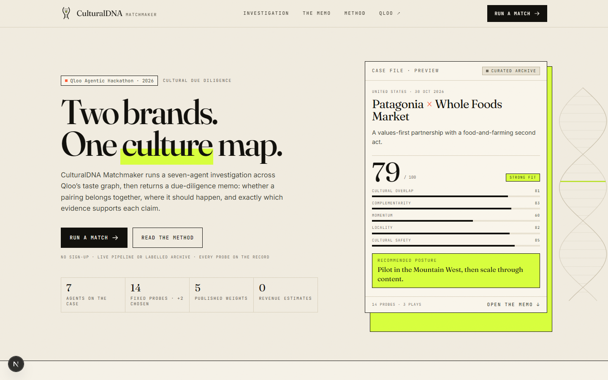
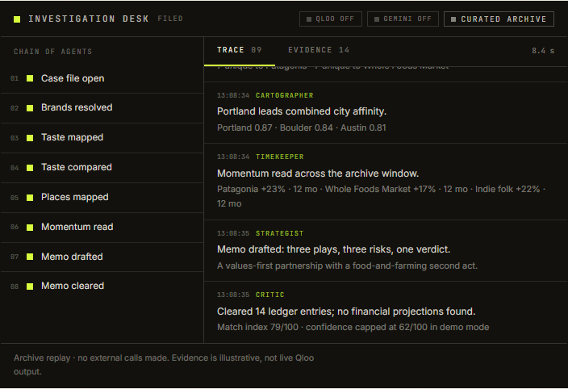
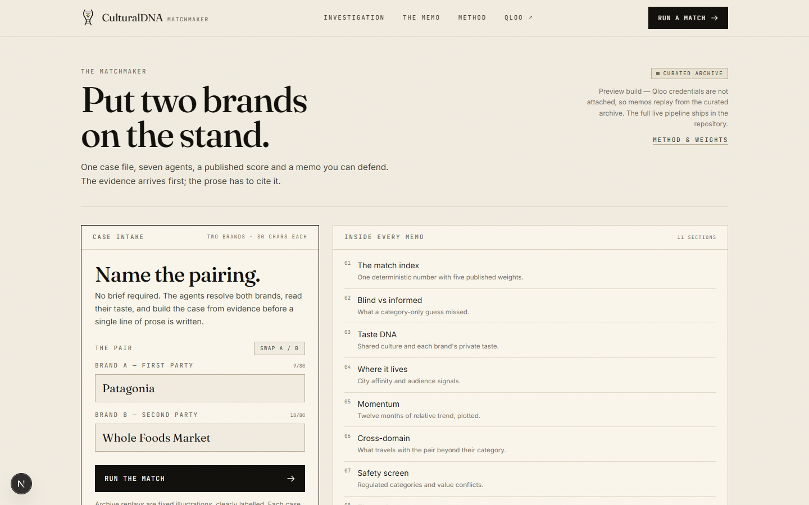
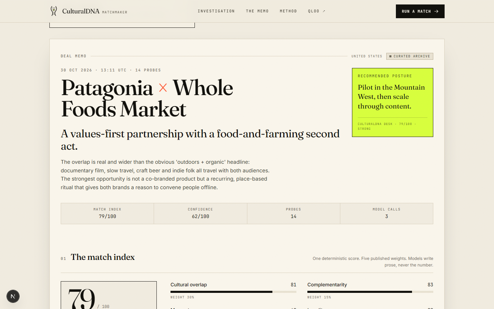

# CulturalDNA Matchmaker

**Cultural due diligence for brand partnerships.** Two brands go on the stand; seven agents investigate Qloo's taste graph, a deterministic scorer produces one match index, and Gemini writes a deal memo that can only cite evidence the probes actually returned.

Built for the **Qloo Agentic Hackathon 2026**.

[Live demo](https://culturaldna-matchmaker.vercel.app) · [Method & weights](https://culturaldna-matchmaker.vercel.app/method) · MIT licensed



---

## The problem

Brand partnerships are usually argued from decks: category adjacency, a handful of demographics, and whoever is loudest in the room. The interesting question is rarely "do both brands talk about sustainability?" It is **whether two audiences actually share a culture** — and where that culture lives.

Qloo answers that with a taste graph. This project turns the graph into a repeatable investigative workflow, then holds the language model to the evidence.

## What it does

Enter two brands. In live mode the pipeline runs 14 fixed Qloo probes, lets Gemini commission up to two more, and streams every step over SSE. You get a deal memo with a score, a blind-test comparison, a taste map, city-by-city activation guidance, cross-domain signals, a safety screen, three plays, risks and a complete evidence ledger.

The demo on the landing page is a **curated archive** — clearly labelled, fixed to the United States, and honest about it. Add a Qloo key and the same pipeline runs live.

### The seven agents

| Agent | Question it answers | Tools |
| --- | --- | --- |
| **Scout** | Do these brands exist as entities? | `/search`, `/entities` |
| **Ethnographer** | What does each audience care about? | `/v2/insights` (tags, demographics, cross-domain) |
| **Diplomat** | What is shared, and what is unique? | `/v2/analysis/compare` |
| **Cartographer** | Where does this culture concentrate? | `/v2/insights` (`urn:heatmap`) |
| **Timekeeper** | Is either audience gaining or losing momentum? | `/v2/trending` (12-month window) |
| **Strategist** | What does it mean, and how would you activate it? | Gemini (blind take, probe plan, memo) |
| **Critic** | Is any of that unsupported? | Deterministic sanitisation and citation repair |

Every stage, trace line and evidence probe streams into the investigation desk as it happens:



### The blind test

Before any Qloo evidence is read, Gemini records the pairing a category-only model would guess. The final memo sets that guess beside the evidence-led verdict and lists what the evidence changed. It is a small honesty device: the model's prior is on the record, not hidden behind a confident paragraph.



## How the match index works

The score is deterministic. Models never touch it.

```
overall = round(
  0.30 × cultural overlap
+ 0.15 × complementarity
+ 0.15 × momentum
+ 0.15 × locality
+ 0.25 × cultural safety
)
```

| Component | Weight | Source |
| --- | --- | --- |
| Cultural overlap | 30% | Shared taste tags from `/v2/analysis/compare`, reconciled against both tag sets |
| Complementarity | 15% | Unique taste on each side — difference is useful when it is legible |
| Momentum | 15% | Brand-level 12-month trend from `/v2/trending` |
| Locality | 15% | Combined city affinity from the heatmap probe |
| Cultural safety | 25% | A published lexicon of regulated categories and value conflicts |

Tiers: **85–100 exceptional · 76–84 strong · 66–75 promising · 52–65 cautious · below 52 weak.**

**Confidence** is a coverage measure, not model certainty: `34 + 10 × passed coverage checks + 6 if live`, clamped to 30–96 and capped at 62 for archive replays. The memo states the formula and the band.

The full method — every probe, every weight, every safety rule, and the eight failure modes — is documented in the app at `/method` and mirrored in [`app/method/page.tsx`](app/method/page.tsx).

## Why the prose can be trusted (a little)

- **Published formula.** The weights and thresholds are constants in [`lib/scoring.ts`](lib/scoring.ts), covered by tests.
- **Evidence ledger.** Every claim in the memo carries references to probe IDs; the UI links each reference to the ledger entry.
- **Deterministic critic.** After Gemini writes, a deterministic pass strips revenue, ROI, market-share and audience-size claims, rejects cities the heatmap did not return, repairs broken citations and removes hype phrasing.
- **No invented numbers.** Affinities are relative signals between 0 and 1. There are no audience sizes, revenue estimates or forecasts anywhere in the product.
- **Demo labels.** Archive memos are marked `CURATED ARCHIVE` in the interface, in the API event stream, and in the memo's own limits section.



## Architecture

```mermaid
flowchart LR
  U[Browser] -->|POST /api/analyze| R[Route handler<br/>SSE stream]
  R --> O[Orchestrator]
  O -->|14 fixed probes| Q[Qloo<br/>hackathon.api.qloo.com]
  O -->|blind take · probe plan · memo| G[Gemini<br/>@google/genai]
  O --> C[Deterministic critic]
  C --> A[Assembled report]
  A -->|stage · trace · evidence · report| U
```

- **Server-only credentials.** `QLOO_API_KEY` and `GEMINI_API_KEY` are read in server modules only; the browser never sees them. Requests use `X-Api-Key` and are restricted to `https://hackathon.api.qloo.com`.
- **Paced Qloo client.** Three concurrent requests, 230 ms minimum start gap, 15 s timeout, four attempts with backoff on 429/5xx, a six-hour 200-entry in-memory cache, and a typed error taxonomy (`QLOO_AUTH`, `QLOO_RATE_LIMIT`, `QLOO_TIMEOUT`, …).
- **Partial evidence is visible.** A failed probe becomes a warning in the trace and a typed fallback; one failure never voids the case.
- **SSE with heartbeats.** The route streams `stage`, `trace`, `evidence`, `warning` and a final `report` event, with 15-second keep-alives and cancellation support.
- **Gemini with a floor.** Three calls at most: blind take, probe plan, memo (45 s timeout). If any call fails or the schema does not validate, a deterministic strategist writes the same memo from the same ledger.

### Qloo endpoints used

`/search` · `/entities` · `/v2/insights` (`urn:tag`, `urn:demographics`, `urn:heatmap`, `urn:entity:artist`, `urn:entity:movie`, `urn:entity:destination`) · `/v2/analysis/compare` · `/v2/trending`

Model-selected probes may add `urn:entity:book`, `podcast`, `tv_show`, `video_game`, `place` or `person`.

## Run it locally

Requirements: Node.js 20+ and a Qloo hackathon key ([hackathon.qloo.com](https://hackathon.qloo.com)).

```bash
npm install
cp .env.example .env.local   # add QLOO_API_KEY and GEMINI_API_KEY
npm run dev                  # http://localhost:3000
```

| Variable | Required | Purpose |
| --- | --- | --- |
| `QLOO_API_KEY` | For live mode | Server-only. Without it the app runs the labelled archive. |
| `QLOO_BASE_URL` | No | Defaults to `https://hackathon.api.qloo.com`. |
| `GEMINI_API_KEY` | No | Enables the blind take, probe planning and memo. Without it a deterministic memo is written. |
| `GEMINI_MODEL` | No | Defaults to `gemini-2.5-flash`. |
| `NEXT_PUBLIC_SITE_URL` | No | Canonical URL for metadata. |

```bash
npm test          # 32 tests: scoring, safety, fixtures, report contracts
npm run typecheck
npm run lint
npm run build
```

## Deploy

The app deploys to Vercel with no extra configuration.

1. Import the repository in Vercel.
2. Add `QLOO_API_KEY`, `GEMINI_API_KEY` and `NEXT_PUBLIC_SITE_URL` as environment variables (server-side scope for the keys).
3. Deploy. The archive works without keys; live mode activates as soon as they are present.

## Project structure

```
app/
  page.tsx              landing — worked case, method summary, archive
  match/page.tsx        match experience (intake → live console → memo)
  method/page.tsx       full method, weights, probes, failure modes, limits
  api/analyze/route.ts  SSE pipeline endpoint
  api/status/route.ts   runtime mode + curated fixtures
components/
  analysis/             intake form, run console, experience shell
  report/               memo renderer: score, blind test, DNA, cities, plays, ledger
lib/
  qloo/                 server-only client + normalisers + 14-probe collector
  agents/               Gemini client, schemas, prompts, blind take, critic, deterministic fallback
  report/               contract assembly
  scoring.ts            published weights, tiers, confidence, safety lexicon
  fixtures/             three curated archive cases
tests/                  scoring, safety, fixtures, report contract
```

## Limits

This is a hackathon build, and the memo says so:

- Affinities are **relative signals**, not audience sizes.
- City affinity measures **cultural concentration**, not sales potential.
- The product deliberately estimates **no revenue, ROI or forecast**.
- The safety screen is a **lexicon, not legal advice**.
- Archive memos are **illustrations**, not live Qloo output.

## License

MIT — see [LICENSE](LICENSE). Not affiliated with Qloo. Qloo's API terms apply to data retrieved through it.
