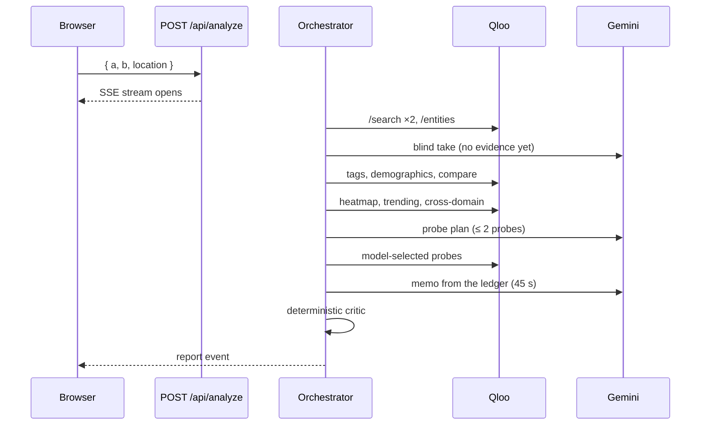

# CulturalDNA Matchmaker

**Cultural due diligence for brand partnerships.** Two brands go on the stand; seven agents investigate Qloo's taste graph, a deterministic scorer produces one match index, and Gemini writes a deal memo that can only cite evidence the probes actually returned.

Built for the **Qloo Agentic Hackathon 2026**.

[Live demo](https://culturaldna-matchmaker.vercel.app) · [The method](https://culturaldna-matchmaker.vercel.app/method) · [Pitch](PITCH.md) · MIT licensed

[](https://github.com/muhamedaldias/culturaldna-matchmaker/actions/workflows/ci.yml)
[](LICENSE)
[](https://nextjs.org)
[](tests)


---

## The premise

Brand partnerships are usually argued from decks: category adjacency, a handful of demographics, and whoever is loudest in the room. The interesting question is never "do both brands talk about sustainability?" It is **whether two audiences actually share a culture — and where that culture lives.**

Qloo answers that with a taste graph. This project turns the graph into a repeatable investigative workflow, then holds the language model to the evidence.

The design rule is simple: **the model narrates; the data decides.** Every score is computed in TypeScript. Every claim points at a probe. Every limitation is printed in the memo.

## At a glance

| | |
| --- | --- |
| Investigation | 7 agents, 14 fixed Qloo probes, up to 2 model-selected probes |
| Verdict | 5 published weights, one deterministic match index, confidence band |
| Narration | Gemini 2.5 Flash, 3 calls maximum, JSON-schema constrained |
| Honesty devices | Blind pre-evidence take, evidence ledger, deterministic critic |
| Resilience | Typed failures, per-probe fallbacks, deterministic memo floor |
| Runtime | Next.js 16 App Router, SSE streaming, Vercel-ready |
| Evidence | 32 unit tests, CI on every push, axe-core WCAG 2.1 AA audit: 0 violations |
| Without keys | A curated archive of three cases, labelled everywhere |

## How a run unfolds

Enter two brands and a market. The pipeline streams every stage over SSE; nothing appears after the fact.

1. **Scout** resolves both names through `/search`, confirms them through `/entities`, and refuses to guess when a brand cannot be found.
2. **Strategist** records a **blind take** — the pairing a category-only model would guess — *before* any Qloo evidence is read.
3. **Ethnographer** maps taste tags, demographic signals and cross-domain affinities (artists, film, destinations) for each brand.
4. **Diplomat** asks Qloo what is shared and what is unique through `/v2/analysis/compare`, then reconciles against both tag sets.
5. **Cartographer** reads a city heatmap for the pair, filtered to the chosen market.
6. **Timekeeper** reads twelve months of brand momentum from `/v2/trending`.
7. **Strategist** may commission up to two extra probes — books, podcasts, TV, games, places or people — if they would change the thesis.
8. **Strategist** writes the memo from the ledger only; the **Critic** strips unsupported claims, canonicalises cities and repairs citations deterministically.

The whole investigation is visible while it happens:


### The seven agents

| Agent | Question it answers | Tools |
| --- | --- | --- |
| **Scout** | Do these brands exist as entities? | `/search`, `/entities` |
| **Ethnographer** | What does each audience care about? | `/v2/insights` — tags, demographics, cross-domain |
| **Diplomat** | What is shared, and what is unique? | `/v2/analysis/compare` |
| **Cartographer** | Where does this culture concentrate? | `/v2/insights` — `urn:heatmap` |
| **Timekeeper** | Is either audience gaining or losing momentum? | `/v2/trending` — 12-month window |
| **Strategist** | What does it mean, and how would you activate it? | Gemini — blind take, probe plan, memo |
| **Critic** | Is any of that unsupported? | Deterministic sanitisation and citation repair |

The blind take matters. Before evidence, the model commits to an answer; the final report sets that guess beside the evidence-led verdict and lists what changed. The model's prior is on the record, not hidden behind a confident paragraph.

## The match index

The score is deterministic. Models never touch it.

```
overall = round(
  0.30 × cultural overlap
+ 0.15 × complementarity
+ 0.15 × momentum
+ 0.15 × locality
+ 0.25 × cultural safety
)
```

| Component | Weight | Source |
| --- | --- | --- |
| Cultural overlap | 30% | Shared taste tags from `/v2/analysis/compare`, reconciled against both tag sets |
| Complementarity | 15% | Exclusive taste breadth on each side — difference is useful when it is legible |
| Momentum | 15% | Brand-level 12-month trend from `/v2/trending`, mapped onto 50 ± 50 |
| Locality | 15% | Combined city affinity from the heatmap probe |
| Cultural safety | 25% | A published lexicon of regulated categories and value conflicts |

Tiers: **85–100 exceptional · 76–84 strong · 66–75 promising · 52–65 cautious · below 52 misaligned.**

**Confidence is coverage, not certainty.** It starts at 34, adds 10 points per passed coverage check (at least 8 shared tags, 6 cities, 2 trend series, 4 demographic segments, 2 cross-domain groups, 8 ledger entries), adds 6 in live mode, clamps to 30–96, and caps at 62 for archive replays. Bands: **≥ 78 high · ≥ 58 moderate · otherwise thin.** The memo prints the formula and the band, because a high score with thin coverage is a warning, not a green light.

Every probe, weight, safety rule and failure mode is published in the app at [`/method`](https://culturaldna-matchmaker.vercel.app/method) and mirrored in [`app/method/page.tsx`](app/method/page.tsx).

## Why the prose can be trusted (a little)

- **Published formula.** Weights and thresholds live in [`lib/scoring.ts`](lib/scoring.ts) and are covered by tests. Changing them changes the tests.
- **Evidence ledger.** Every claim carries references to probe IDs; the interface links each reference to its ledger row.
- **Deterministic critic.** After Gemini writes, a rule-based pass removes revenue, ROI, market-share and audience-size claims, rejects cities the heatmap did not return, repairs broken citations and strips hype phrasing.
- **No invented numbers.** Affinities are relative signals between 0 and 1. The product contains no audience sizes, revenue estimates, forecasts or valuation.
- **Labels everywhere.** Archive memos are marked `CURATED ARCHIVE` in the interface, in the SSE stream, and in the memo's own limits section.
- **A floor, not a cliff.** If Gemini fails, times out or returns invalid JSON, a deterministic strategist writes the same memo from the same ledger.


## Architecture

```mermaid
flowchart LR
  U[Browser] -->|POST /api/analyze| R[Route handler<br/>SSE stream]
  R --> O[Orchestrator]
  O -->|14 fixed probes| Q[Qloo<br/>hackathon.api.qloo.com]
  O -->|blind take · probe plan · memo| G[Gemini<br/>@google/genai]
  O --> C[Deterministic critic]
  C --> A[Assembled report]
  A -->|mode · stage · trace · evidence · report| U
```



- **Server-only credentials.** `QLOO_API_KEY` and `GEMINI_API_KEY` are read in server modules only. Qloo requests use `X-Api-Key` and are pinned to `https://hackathon.api.qloo.com`; a custom base URL is refused unless `QLOO_ALLOW_CUSTOM_BASE_URL=1` is set for a local mock.
- **Paced client.** Three concurrent requests, a 230 ms minimum gap between starts, a 15 s request timeout, four attempts with backoff on 429/5xx (honouring `Retry-After`), a six-hour 200-entry in-memory cache, and a typed error taxonomy — `QLOO_AUTH`, `QLOO_RATE_LIMIT`, `QLOO_TIMEOUT`, `QLOO_CONTRACT`, `QLOO_CANCELLED`, and friends.
- **Partial evidence stays visible.** A failed probe becomes a warning in the trace and a typed fallback; one failure never voids the case.
- **SSE with heartbeats.** The route emits `mode`, `stage`, `trace`, `evidence`, `report` and `error` events, sends a comment every 15 s to survive proxies, sets `X-Accel-Buffering: no`, and supports cancellation.
- **Gemini with a floor.** Three calls at most — blind take, probe plan, memo (45 s deadline). Any failure or schema violation falls back to the deterministic strategist.

### API

`POST /api/analyze` accepts JSON and answers with an SSE stream.

```jsonc
{ "a": "Patagonia", "b": "Whole Foods Market", "location": "United States" }
```

Names are trimmed and capped at 80 characters, locations at 60. `mode: "demo" | "live"` and `fixture` are optional; demo runs accept only curated pairs. Each event is one `data:` frame:

```text
data: {"type":"stage","agent":"ethnographer","status":"start","label":"Mapping taste","at":"…"}
data: {"type":"trace","entry":{"id":"…","agent":"diplomat","message":"…","status":"done","at":"…"}}
data: {"type":"evidence","probe":{"id":"live-heatmap","endpoint":"/v2/insights","resultCount":50,"mode":"live","…":"…"}}
data: {"type":"report","report":{"scores":{"overall":79,"confidence":88},"…":"…"}}
```

`GET /api/status` returns the runtime mode, which providers are configured, the reason for the mode, and the available archive fixtures — the UI uses it to label the demo honestly.

### Qloo endpoints used

| Endpoint | Used for | Agent |
| --- | --- | --- |
| `/search` | Resolve a brand name to an entity | Scout |
| `/entities` | Confirm the resolved records | Scout |
| `/v2/insights` — `urn:tag` | Taste tags per brand | Ethnographer |
| `/v2/insights` — `urn:demographics` | Relative audience signals | Ethnographer |
| `/v2/insights` — `urn:entity:artist` · `urn:entity:movie` · `urn:entity:destination` | Cross-domain culture | Ethnographer |
| `/v2/analysis/compare` | Shared versus unique taste | Diplomat |
| `/v2/insights` — `urn:heatmap` | City-level cultural concentration | Cartographer |
| `/v2/trending` | Twelve-month brand momentum | Timekeeper |
| `/v2/insights` — model choice | Books, podcasts, TV, games, places, people | Strategist |

No `/recs` or `/recommendations` call is made anywhere in the codebase; the workflow is built on search, entities, insights, comparison and trending only.

## Run it locally

Requirements: **Node.js 20.9+** and, for live mode, a Qloo hackathon key from [hackathon.qloo.com](https://hackathon.qloo.com).

```bash
npm install
cp .env.example .env.local     # add QLOO_API_KEY and GEMINI_API_KEY
npm run dev                    # http://localhost:3000
```

| Variable | Required | Purpose |
| --- | --- | --- |
| `QLOO_API_KEY` | For live mode | Server-only. Without it the app runs the labelled archive. |
| `QLOO_BASE_URL` | No | Defaults to `https://hackathon.api.qloo.com`. |
| `GEMINI_API_KEY` | No | Enables the blind take, probe planning and memo. Without it a deterministic memo is written. |
| `GEMINI_MODEL` | No | Defaults to `gemini-2.5-flash`. |
| `NEXT_PUBLIC_SITE_URL` | No | Canonical URL for metadata and Open Graph. |

### Reproduce the archive

Open `/match` and pick a case, or run one directly:

| Case | Fixture | Market |
| --- | --- | --- |
| Patagonia × Whole Foods Market | `patagonia-whole-foods` | United States |
| Nike × Spotify | `nike-spotify` | Global |
| Rolex × Red Bull | `rolex-red-bull` | Global |

```text
/match?fixture=patagonia-whole-foods&autorun=1
```

Archive data is hand-authored for illustration; it is not Qloo output and is labelled as such in the memo, the console and the API.

## Quality gates

```bash
npm test          # 32 tests: scoring, safety, confidence, fixtures, report contracts
npm run typecheck
npm run lint
npm run build
```

- **CI** runs all four on Node 22 for every push and pull request.
- **Accessibility:** axe-core (WCAG 2.1 AA) audit reports zero violations on the landing page, the match intake, the method page and a completed memo; the console is keyboard-scrollable, focus rings adapt on the dark surface, and motion respects `prefers-reduced-motion`.
- **Responsive:** verified from 320 px to 1440 px with no horizontal overflow; the header collapses its call to action below 480 px.
- **Streaming:** the full SSE run was replayed against `next start` (43 events, no buffering) and the browser console stayed clean.
- **Secrets:** the production client bundle contains neither key nor key names; `.env.local` is ignored by git.

## Deploy

The app deploys to Vercel with no extra configuration.

1. Import the repository in Vercel.
2. Add `QLOO_API_KEY`, `GEMINI_API_KEY` and `NEXT_PUBLIC_SITE_URL` as environment variables. Keys are server-side only.
3. Deploy. The archive works without keys; live mode activates as soon as they are present.

## Project structure

```text
app/
  page.tsx                 landing — worked case, method summary, archive
  match/page.tsx           match experience (intake → live console → memo)
  method/page.tsx          full method, weights, probes, failure modes, limits
  api/analyze/route.ts     SSE pipeline endpoint
  api/status/route.ts      runtime mode, provider status, fixture list
components/
  analysis/                intake form, run console, experience shell
  report/                  memo renderer: score, blind test, DNA, cities, plays, ledger
lib/
  qloo/                    server-only client, normalisers, 14-probe collector
  agents/                  Gemini client, schemas, prompts, blind take, probes, critic, fallback
  report/                  contract assembly
  scoring.ts               published weights, tiers, confidence, safety lexicon
  fixtures/                three hand-authored archive cases
tests/                     scoring, safety, fixtures, report contracts
```

## Failure modes

| Condition | Behaviour |
| --- | --- |
| `QLOO_API_KEY` missing | The run uses the curated archive, clearly labelled; a custom pair is refused with a recovery message instead of a fabricated memo. |
| `GEMINI_API_KEY` missing | The blind take falls back to a category heuristic, probe planning is skipped, and the deterministic strategist writes the memo from the same ledger. |
| Gemini timeout or schema failure | The 45-second memo call is abandoned, the deterministic memo is used, and a warning is written into the memo caveats and the trace. |
| A single Qloo probe fails | The probe is logged as a warning and the run continues with a typed fallback — a neutral momentum, an empty city list — so one failure never voids the case. |
| A brand cannot be resolved | A `QLOO_CONTRACT` error stops the run with a recovery prompt. Nothing is inferred from the name. |
| Rate limit or upstream outage | Four attempts with backoff and a 15-second timeout, then a typed error. Archive cases remain available. |
| The model invents a city or citation | The critic rebuilds citations from the ledger and canonicalises cities to the returned locality list, or refuses the claim. |
| Financial or audience-size claims | The critic removes sentences containing revenue, ROI, market-share, audience-size or percentage-of-population claims, and strips hype phrasing. |

The full table, with the eight conditions above and their code paths, lives at `/method#limits`.

## Limits and non-goals

- Affinities are **relative signals**, not audience sizes.
- City affinity measures **cultural concentration**, not sales potential.
- The product deliberately estimates **no revenue, ROI, forecast or sponsorship valuation**.
- The safety screen is a **lexicon, not legal advice**.
- Archive memos are **illustrations**, not live Qloo output.
- There is no monitoring between runs and no visibility into either brand's contracts or internal strategy.

## Roadmap

- Saved workspaces that compare pairings over time.
- Re-running pinned probes after Qloo data refreshes, with a diff against the previous memo.
- A sponsorship-fit variant that keeps the same ledger and critic.
- Publishing the safety lexicon for outside review.

## Docs

- [`PITCH.md`](PITCH.md) — the two-minute story, rubric alignment and demo beats.
- [`/method`](https://culturaldna-matchmaker.vercel.app/method) — every probe, weight, safety rule and failure mode, in the product.
- [`docs/screenshots/`](docs/screenshots) — desktop and mobile captures used in this README.

## Acknowledgements

Qloo for the taste graph and the hackathon; Google for Gemini; the Next.js, React and Vercel teams for the stack this runs on. Not affiliated with Qloo.

## License

MIT — see [LICENSE](LICENSE). Qloo's API terms apply to data retrieved through the API.
